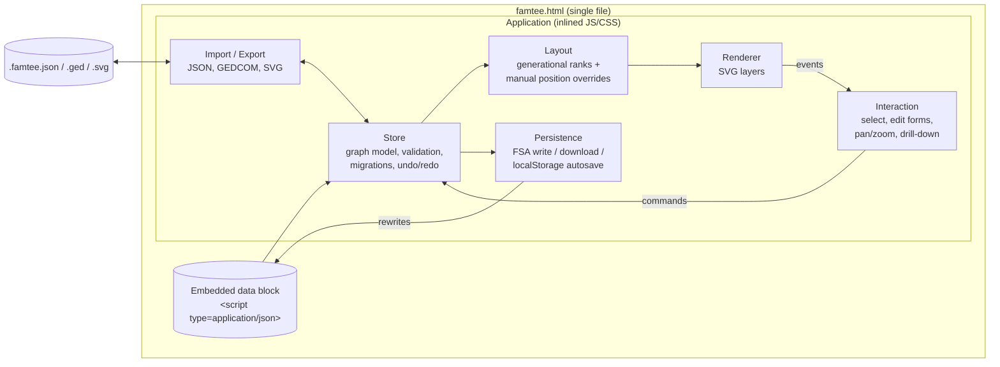

# FamTee Architecture

Status: Accepted (architecture session, 2026-10-12)

## Goals

- **Portable**: one artifact that can be emailed, copied to a USB stick or synced via any cloud drive.
- **Media/OS indifferent**: runs in any modern browser (Chromium, Firefox, Safari) on Windows, macOS, Linux,
  ChromeOS, and tablets — straight from `file://`, fully offline.
- **Data + visualization together**: the file *is* the family tree; no separate viewer to install.
- **Graph-native**: people and relations form a graph; multiple graphs can interconnect at different levels.
- **Editable in the browser** with save-back to the file.
- **Lightweight**: no UI framework; a few vendored micro-libraries at most.
- **Future-proof for design**: a graphic-design overlay can be added later without changing the data model.

## Non-goals (for now)

- Server, accounts, multi-user real-time collaboration.
- Large-scale genealogy (target is **50–100 people per file**; see ADR 0003/0008).
- Being a GEDCOM-native editor (GEDCOM is an adapter, ADR 0010).

## Hard constraints that shaped the design

| Constraint | Consequence |
|---|---|
| Must work from `file://` | No `fetch()` of sibling files, no ES-module imports at runtime → everything inlined in dist (ADR 0001, 0002) |
| Must work offline | No CDN; dependencies vendored and inlined (ADR 0007) |
| Any browser | File System Access API only where available; download fallback elsewhere (ADR 0006) |
| Future design overlay | Vector rendering with explicit layers (ADR 0003, 0009) |

## Component view



### Components

- **Store** — single source of truth for the document ([data-model.md](data-model.md)). All mutations go
  through command objects (`addPerson`, `link`, `movePosition`, …) so undo/redo and dirty-tracking are free.
  Validates referential integrity, runs `schemaVersion` migrations on load.
- **Layout** — pure function `(graph, overrides) → positions`. Custom generational algorithm (ADR 0008).
  Manually dragged nodes keep their stored `pos`.
- **Renderer** — draws one graph at a time into an `<svg>` with fixed layers (ADR 0003). Re-renders from
  Store + Layout; no hidden state.
- **Interaction** — pan/zoom (`d3-zoom`), selection, side-panel edit forms, breadcrumb navigation between
  graph levels (drill into `graphRef` nodes, follow cross-graph `links`).
- **Persistence** — serializes the Store and writes the whole HTML back with the data block replaced (ADR 0006).
- **Import/Export** — `.famtee.json` (native, lossless), GEDCOM 5.5.1/7 (lossy adapter, ADR 0010), standalone
  SVG/print.

## Proposed repository layout

```
src/
  index.html        # shell template with <!-- INLINE --> markers and an empty data block
  main.js           # bootstraps: read data block → Store → Render
  store/            # model, commands, undo, validation, migrations
  layout/           # generational layout
  render/           # SVG layers, node/edge shapes, themes (CSS)
  ui/               # panels, forms, navigation, keyboard shortcuts
  persist/          # fsa.js, download.js, autosave.js
  io/               # json.js, gedcom.js, svg-export.js
  styles/           # CSS (themable via custom properties)
vendor/             # pinned d3 modules + LICENSE files (ADR 0007)
build/build.mjs     # bundles + inlines everything into dist/famtee.html
samples/            # example .famtee.json files
dist/famtee.html    # the shippable single file
docs/
```

Development: open `src/index.html` through any static server (`python3 -m http.server`) to use ES modules
directly; the build produces the `file://`-safe single file.

## Browser support matrix

| Capability | Chromium (Chrome/Edge/Brave) | Firefox | Safari |
|---|---|---|---|
| Open & view from `file://` | ✅ | ✅ | ✅ |
| Edit in browser | ✅ | ✅ | ✅ |
| Save in place (overwrite file) | ✅ File System Access API | ⬇️ download new copy | ⬇️ download new copy |
| Autosave draft recovery | ✅ localStorage | ✅ | ✅ (may be cleared after 7 days of non-use) |
| Import / export JSON & GEDCOM | ✅ | ✅ | ✅ |

## Open questions

1. Single-graph-per-view vs. showing linked graphs side by side (start with drill-down + breadcrumb).
2. Media (photos): embed as data URIs (portable, bloats file) or reference sibling files (lighter, breaks
   single-file portability). Proposed default: embed thumbnails, optional external originals.
3. Privacy: optional "export without living persons" filter before sharing.
4. Encryption of the embedded data block (password-protected file) — possible later via WebCrypto.
5. GEDCOM version priority: 5.5.1 (widest support) vs 7.0.
